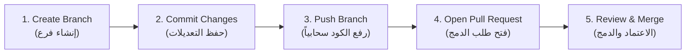

# Techouse - Group 2 (G2): Git & GitHub Masterclass
### دليل GitHub الشامل — أساسيات مشاركة وإدارة الأكواد البرمجية

[](https://git-scm.com/)
[](https://github.com/)
[](https://git-lfs.github.com/)
[](LICENSE)

---

## 📌 Overview

Welcome to the **Techouse Group 2 (G2)** repository. This workspace contains the complete educational resources, workshop presentation slides, and recorded lecture and practical sessions for the **"Comprehensive Git & GitHub Guide for Beginners"** (*دليل GitHub الشامل للمبتدئين*), delivered as part of the **Techouse / Discover Bechar** initiative.

This training equips developers and designers with foundational version control skills, moving from isolated local code writing to professional cloud-based collaboration.

---

## 📂 Repository Structure

The repository has been structured cleanly into modular directories for ease of navigation:

```plaintext
techouse-g2/
├── docs/
│   └── دليل GitHub الشامل للمبتدئين.pptx   # Official workshop slide deck (23 slides)
├── notes/
│   └── dalil-moulay_AI.txt                 # Session summary & mentor notes
├── videos/
│   ├── lsn.mp4                             # Part 1: Theoretical lecture (140 MB)
│   └── pratique.mp4                        # Part 2: Hands-on practical lab (287 MB)
├── .gitattributes                          # Git Large File Storage (LFS) rules for media
├── .gitignore                              # Excluded environment and OS files
└── README.md                               # Project documentation and video index
```

---

## 🎥 Workshop Video Sessions

The workshop is divided into two comprehensive recorded sessions: a theoretical lecture covering core version control mechanics, and a hands-on live terminal lab.

### 1. Theoretical Session: Core Concepts & Architecture (`lsn.mp4`)
* **Topic:** Version control theory, the architectural distinction between Git and GitHub, repository anatomy, and team workflows.
* **Format:** MP4 Video | ~140 MB
* **Direct File Link:** [📂 `videos/lsn.mp4`](videos/lsn.mp4)

<div align="center">
  <video src="videos/lsn.mp4" controls width="100%" poster="">
    <p>Your browser does not support HTML5 video. You can <a href="videos/lsn.mp4">download or view the video directly</a>.</p>
  </video>
</div>

> 💡 *If the inline video player is not rendered by your Git viewer, open or download the file directly from [videos/lsn.mp4](videos/lsn.mp4).*

---

### 2. Practical Lab: Terminal Commands & Collaboration (`pratique.mp4`)
* **Topic:** Hands-on setup, initialization, everyday Git commands (`clone`, `add`, `commit`, `push`, `pull`), feature branching, opening Pull Requests (PRs), and code reviews.
* **Format:** MP4 Video | ~287 MB
* **Direct File Link:** [📂 `videos/pratique.mp4`](videos/pratique.mp4)

<div align="center">
  <video src="videos/pratique.mp4" controls width="100%" poster="">
    <p>Your browser does not support HTML5 video. You can <a href="videos/pratique.mp4">download or view the video directly</a>.</p>
  </video>
</div>

> 💡 *If the inline video player is not rendered by your Git viewer, open or download the file directly from [videos/pratique.mp4](videos/pratique.mp4).*

---

## 📊 Summary of Video & Media Resources

| Resource | Filename | Size | Scope | Link |
| :--- | :--- | :--- | :--- | :--- |
| **Theoretical Lecture** | `lsn.mp4` | ~140 MB | Git vs GitHub, 4 Core Pillars, Workflow Cycle | [▶️ View Video](videos/lsn.mp4) |
| **Practical Workshop** | `pratique.mp4` | ~287 MB | Live Terminal Commands, Staging, Push/Pull & PR | [▶️ View Video](videos/pratique.mp4) |
| **Slide Deck** | `دليل GitHub الشامل للمبتدئين.pptx` | ~24.2 MB | 23 Presentation Slides (Arabic) | [📄 View Slides](docs/دليل%20GitHub%20الشامل%20للمبتدئين.pptx) |
| **Mentor Notes** | `dalil-moulay_AI.txt` | Text | Syllabus & Outline | [📝 View Notes](notes/dalil-moulay_AI.txt) |

---

## 📖 Curriculum Breakdown (From Presentation)

The workshop companion slide deck ([`docs/دليل GitHub الشامل للمبتدئين.pptx`](docs/دليل%20GitHub%20الشامل%20للمبتدئين.pptx)) covers the following roadmap:

### 1. Git vs. GitHub
* **Git (Local VCS):** A command-line version control system installed locally to track file revisions over time. Works 100% offline.
* **GitHub (Cloud Collaboration):** A web-based hosting platform for Git repositories. Facilitates team code reviews, CI/CD, issue tracking, and developer portfolios.

### 2. The Four Pillars of GitHub (أهم 4 مفاهيم)
1. **Repository (المستودع):** The root container containing all project files, history, branches, and commit records.
2. **Commit (الحفظ والتسجيل):** An immutable checkpoint/snapshot of changes made to the codebase, tagged with a descriptive message.
3. **Branch (الفرع المستقل):** An isolated workspace diverging from the main line of development, allowing features to be built safely.
4. **Pull Request (طلب الدمج والمراجعة):** A formal proposal to review, discuss, and integrate changes from a feature branch into the target branch.

### 3. The 5-Step Collaboration Lifecycle (دورة العمل القياسية)


---

## ⚡ Git Essential Commands Reference

| Command | Action | Scope |
| :--- | :--- | :--- |
| `git clone <repository-url>` | Clone a remote repository to your local machine | Remote → Local |
| `git status` | Inspect working directory and staged file states | Local |
| `git checkout -b <branch-name>` | Create and switch to a new isolated feature branch | Local |
| `git add .` | Stage modified files for the next commit | Local (Staging) |
| `git commit -m "feat: description"` | Save staged snapshot with a descriptive message | Local (Repository) |
| `git pull origin <branch-name>` | Fetch and merge remote changes into current branch | Remote → Local |
| `git push origin <branch-name>` | Upload local commits to remote GitHub repository | Local → Remote |

---

## 🚀 Cloning & Working with Large Files (Git LFS)

Because the recorded videos (`lsn.mp4` and `pratique.mp4`) exceed standard Git file size limitations, this repository utilizes **[Git LFS (Large File Storage)](https://git-lfs.github.com/)**.

### Prerequisites:
Make sure Git LFS is installed on your machine:
```bash
git lfs install
```

### Clone the Repository with Media:
```bash
# Clone the repository
git clone https://github.com/dalil-moulayabdelhakim-dev/techouse-g2.git

# Enter the project directory
cd techouse-g2

# Pull down the full media files via Git LFS
git lfs pull
```

---

## 🛡️ Best Practices for Beginners
1. **Write Descriptive Commit Messages:** Use imperative, clear commit summaries (e.g., `feat: implement user registration form` instead of `update`).
2. **Make Small, Atomic Commits:** Group logical changes together rather than saving monolithic blocks of work.
3. **Never Commit Secrets:** Keep passwords, API tokens, and `.env` files out of Git tracking. Always configure `.gitignore`.
4. **Pull Before You Push:** Run `git pull` before beginning work to ensure your local branch is synchronized with the latest remote code.

---

## 👨‍🏫 Mentorship & Credits

* **Instructor / Mentor:** **Dalil Moulay Abdelhakim** (*Computer Science Engineer & Digitization Lead, Directorate of Education - Béni Abbès*)
* **Supervision & Coordination:** **Prof. Nadia Rahmani** (*الأستاذة رحماني نادية*)
* **Initiative:** **Techouse / Discover Bechar** (المجموعة الثانية — Group 2)
